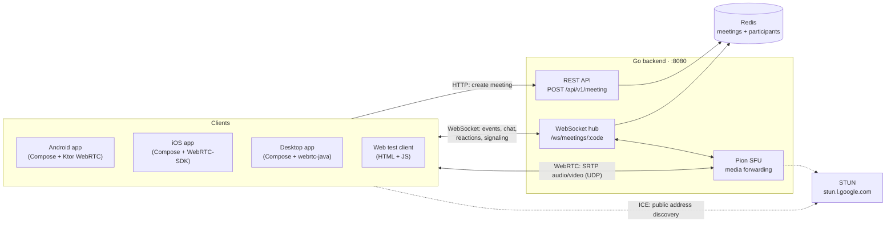
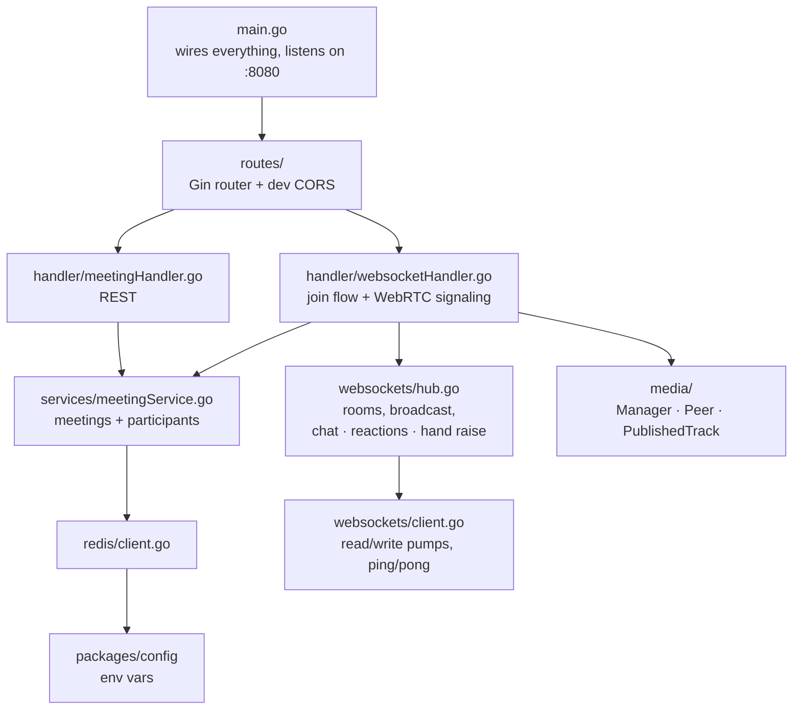
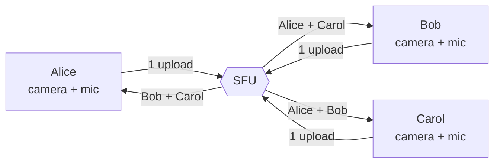
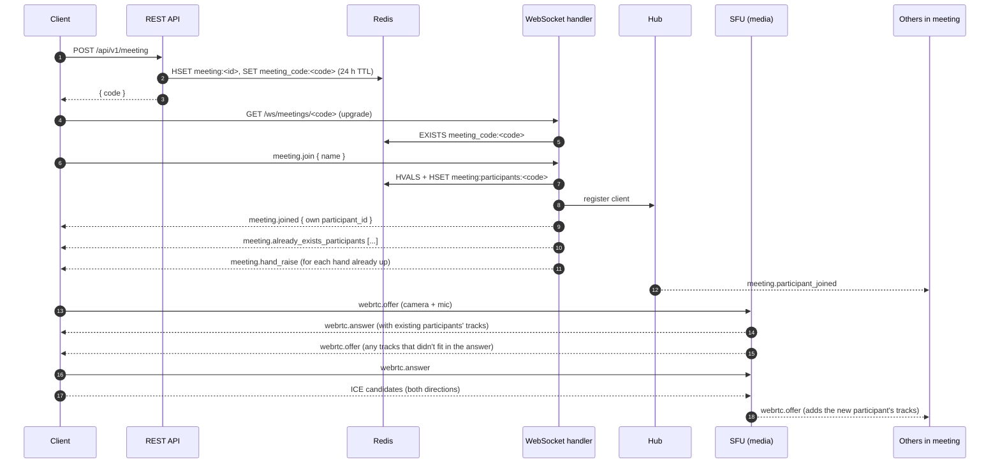
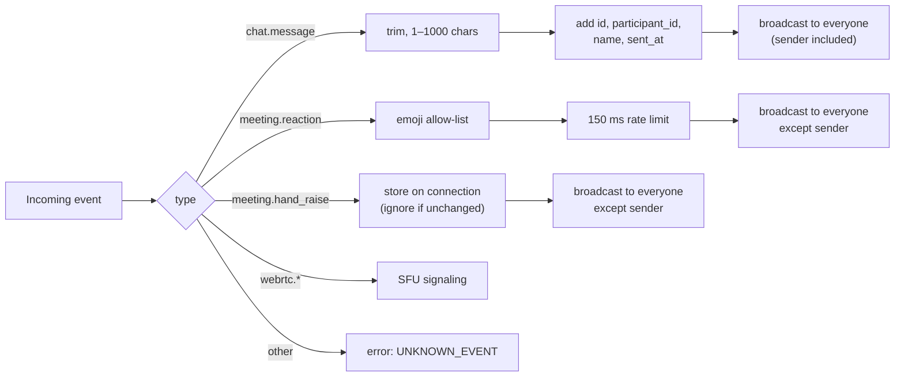
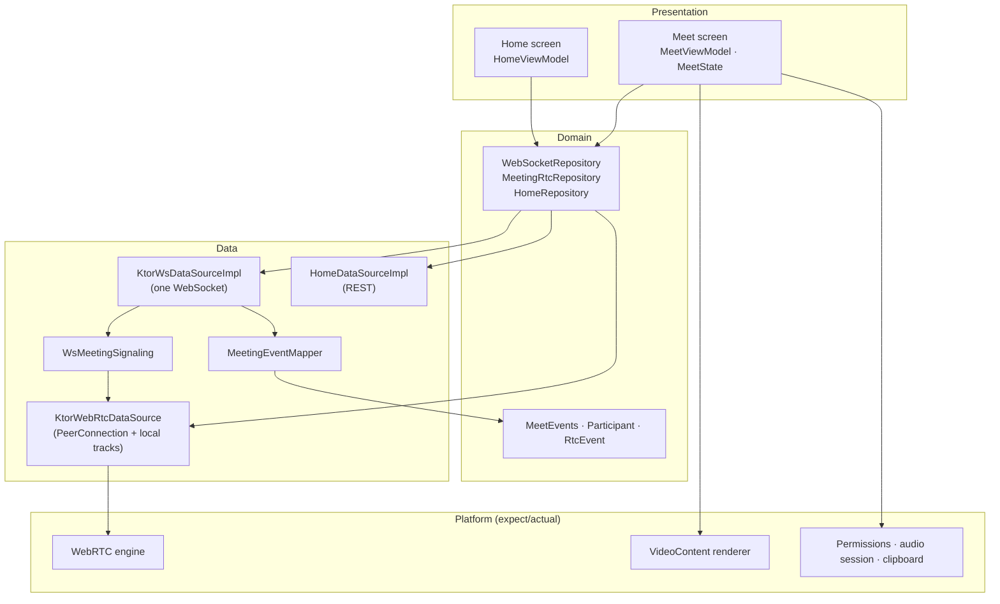

# Architecture

Leet is a group video-calling app built around a **Selective Forwarding Unit (SFU)**. Each participant uploads their camera and microphone once. The Go server forwards those streams to everyone else in the meeting without decoding or re-encoding them.

- [System overview](#system-overview)
- [Backend](#backend)
- [Media path (SFU)](#media-path-sfu)
- [Joining a call](#joining-a-call)
- [Chat, reactions and raised hands](#chat-reactions-and-raised-hands)
- [Where state lives](#where-state-lives)
- [Client (Kotlin Multiplatform)](#client-kotlin-multiplatform)
- [Design decisions](#design-decisions)

Related docs: [protocol.md](protocol.md) (every event and payload) · [infra.md](infra.md) (ports, Redis, deployment).

## System overview

Each client uses three channels:

| Channel | Transport | Carries |
| --- | --- | --- |
| REST | HTTP | Creating a meeting |
| WebSocket | TCP | Join/leave, participant list, chat, reactions, raised hands, WebRTC offer/answer/ICE |
| WebRTC | UDP (SRTP/SRTCP) | Audio and video, plus RTCP feedback such as keyframe requests |

## Backend

The backend is a single Go binary (`apps/api/cmd/server`).

| Package | Responsibility |
| --- | --- |
| `routes` | HTTP routes and the CORS middleware used by the web test client |
| `handler` | Turns HTTP requests into service calls. Runs the WebSocket join handshake and routes `webrtc.*` events to the SFU |
| `websockets` | One `Client` per connection with separate read and write goroutines. The `Hub` groups clients by meeting code, broadcasts events, and handles chat, reactions and raised hands |
| `media` | One Pion `PeerConnection` per participant. `Manager` tracks every published track and attaches it to every other peer in the meeting |
| `services` | Meeting and participant storage in Redis |
| `utils` | JSON response envelope and error helpers |

## Media path (SFU)

- **Publishing:** when a client's offer brings in a track, `Manager.PublishTrack` wraps it in a `PublishedTrack` and adds a matching local track to every other peer in the meeting. Each of those peers then renegotiates, so the server sends it a new `webrtc.offer`.
- **Forwarding:** RTP packets are copied from the incoming track to every outgoing track as they arrive. Nothing is decoded.
- **Naming:** each forwarded track and stream id is `"<participantId>:<originalId>"`. Clients split on `:` to find whose video a track is.
- **Keyframes:** a new subscriber needs a keyframe before it can show video. The server sends a PLI (picture loss indication) to the publisher when a track is attached, and forwards PLI/FIR requests from subscribers back to the publisher.
- **Codecs:** the server offers only **VP8** and **Opus**. Since packets are forwarded as they are, every subscriber has to decode whatever the publisher sends, so everyone uses one codec every platform can decode (see [Design decisions](#design-decisions)).

## Joining a call

When a client disconnects, its read loop ends. The server then removes it from the hub, closes its `PeerConnection` (which removes its tracks from everyone else, triggering renegotiation), deletes it from Redis and broadcasts `meeting.left`.

## Chat, reactions and raised hands

None of these are stored. The hub validates each one, adds the sender's identity from the connection (never from the payload), and broadcasts it.

- **Chat** is echoed back to the sender. Clients add a message to the list only when the echo arrives, so a message that failed to send never shows as sent.
- **Reactions and raised hands** appear on the sender's screen immediately, so the server doesn't send them back.
- **Raised hands** are kept in memory on the connection, so the server can tell people who join later whose hands are up. Disconnecting clears the hand.

## Where state lives

| State | Location | Lifetime |
| --- | --- | --- |
| Meeting (id, code, status) | Redis | 24 hours |
| Participant list | Redis | Until the participant leaves (key expires after 24 h) |
| WebSocket connections, rooms | Server memory (`Hub`) | While connected |
| Raised hand | Server memory (`Client`) | While connected |
| Peer connections, published tracks | Server memory (`media.Manager`) | While connected |
| Chat messages | Each client's memory only | Until that client leaves |
| Reactions | Nowhere, broadcast only | ~3 seconds on screen |

Because connections and media live in memory, all participants of a meeting must reach the **same server process**. See [infra.md](infra.md#scaling).

## Client (Kotlin Multiplatform)

One shared module (`apps/frontend/shared`) holds the UI, ViewModels and networking for Android, iOS and desktop. Each platform only supplies its WebRTC engine, video renderer, permissions, audio routing and clipboard entry.

- One WebSocket per meeting carries everything. `MeetingEventMapper` turns frames into `MeetEvents` for the ViewModel, and `WsMeetingSignaling` picks out the `webrtc.*` frames for the RTC repository.
- `MeetViewModel` holds `MeetState` (participants, messages, reactions, panels, video tracks) and handles every `MeetAction` from the UI.
- Dependency injection uses Koin. `AppModules.kt` holds the shared bindings, and each platform adds its own `platformModule`.

| | Android | iOS | Desktop |
| --- | --- | --- | --- |
| WebRTC | `AndroidWebRtc` (stream-webrtc) | `IosWebRtc` (WebRTC-SDK) | `JvmWebRtc` (webrtc-java) |
| Video view | `SurfaceViewRenderer` | `RTCMTLVideoView` | Frames drawn as Compose `ImageBitmap` |
| Default server host | `10.0.2.2` (emulator) | `localhost` | `localhost` |

## Design decisions

**SFU instead of peer-to-peer mesh.** In a mesh, each person uploads their video once per other participant, which phones can't keep up with past three or four people. With an SFU each client uploads once, and the server's bandwidth grows with the size of the meeting instead.

**Forward packets, don't transcode.** Forwarding is cheap and adds almost no delay, but the server can't change codecs, so all clients must share one.

**VP8 and Opus only.** Every platform can encode and decode VP8. With Pion's default codec list, iOS chose H264, and the Android emulator's hardware H264 decoder can't render WebRTC video. Allowing only VP8 removes that kind of mismatch. The cost is that iPhones encode VP8 in software instead of H264 in hardware.

**Chat is not stored.** It's a requirement: messages exist only for the people in the meeting at the time. This also means no database writes on the chat path.

**The server sets the sender's identity.** The hub fills `participant_id` and `name` from the connection's join, so a client can't post as someone else in the same meeting. (There are no user accounts yet; a name is whatever the person typed when joining.)

**Validate and rate-limit at the hub.** Message length, the emoji allow-list and the reaction rate limit are enforced in one place for every client, including the web client.
