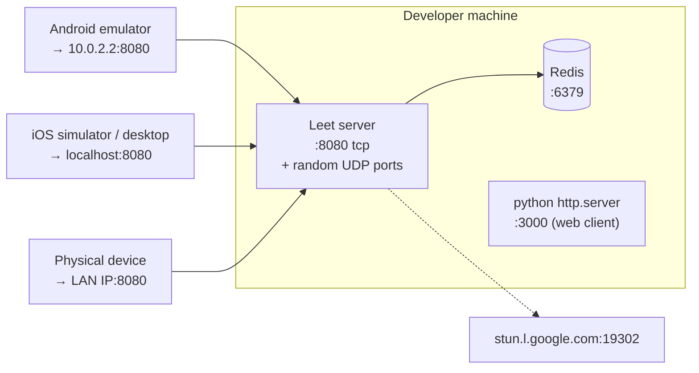
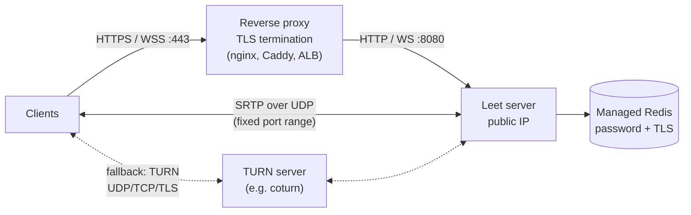

# Infrastructure

What Leet needs to run: processes, ports, Redis data, configuration, and what has to change before it runs on the internet.

- [Components](#components)
- [Network and ports](#network-and-ports)
- [Redis data model](#redis-data-model)
- [Configuration](#configuration)
- [Local development](#local-development)
- [Bandwidth and sizing](#bandwidth-and-sizing)
- [Scaling](#scaling)
- [Production checklist](#production-checklist)
- [Observability](#observability)

Related docs: [architecture.md](architecture.md) · [protocol.md](protocol.md).

## Components

| Component | What it is | Required |
| --- | --- | --- |
| **Leet server** | One Go binary: REST API, WebSocket hub and Pion SFU (`apps/api/cmd/server`) | Yes |
| **Redis 6+** | Meetings and participant lists | Yes; the server exits if it can't reach Redis at startup |
| **STUN server** | Google's public `stun.l.google.com:19302`, used by the server and all clients | Yes, hard-coded |
| **TURN server** | Relays media when a direct UDP path isn't possible | Not configured (see [checklist](#production-checklist)) |
| **Static file host** | Serves `apps/web-client` | Only for the web test client |

### Current topology (development)



### Recommended topology (production)



Media doesn't go through the HTTP reverse proxy. Clients send UDP straight to the server's public IP, or through TURN, so the server host needs a public address and open UDP ports.

## Network and ports

| Port | Protocol | Direction | Used for |
| --- | --- | --- | --- |
| `8080` | TCP | Inbound | REST (`/api/v1/*`) and WebSocket (`/ws/meetings/:code`). Hard-coded in `main.go`. |
| Ephemeral UDP | UDP | Inbound + outbound | ICE and SRTP media. Pion picks random ports because no port range is configured. |
| `6379` | TCP | Server → Redis | Redis |
| `19302` | UDP | Outbound | STUN (server and clients) |
| `3000` (any) | TCP | Inbound | Static host for the web client (dev only) |

Notes:

- **Random UDP ports** are fine on a laptop. Behind a firewall or in a container you need a fixed range so you can open it. Pion supports this through `SettingEngine.SetEphemeralUDPPortRange` (or a single-port UDP mux); `media.NewPeer` would need to set it.
- **NAT / cloud VMs:** if the server sits behind 1:1 NAT (for example an EC2 instance with an elastic IP), set the public IP with `SettingEngine.SetNAT1To1IPs`. Otherwise its ICE candidates advertise the private address and only STUN-discovered candidates are reachable.
- **WebSocket keep-alive:** the server pings every 54 s and drops a connection after 60 s without a pong. Any proxy in front must allow idle WebSocket connections for longer than 60 s.

## Redis data model

All keys expire after 24 hours, so a meeting code stops working one day after it was created.

| Key | Type | Value | TTL | Written by |
| --- | --- | --- | --- | --- |
| `meeting:<uuid>` | Hash | `id`, `code`, `status` | 24 h | `CreateMeeting` |
| `meeting_code:<code>` | String | Meeting uuid (reverse lookup) | 24 h | `CreateMeeting` |
| `meeting:participants:<code>` | Hash | `participantId` → `{"participant_id","name"}` JSON | 24 h, refreshed on every join | `AddParticipant`, `RemoveParticipant` |

What is **not** in Redis: chat messages, reactions, raised hands, WebSocket connections and media state. Those exist only in server memory or on the clients (see [architecture.md](architecture.md#where-state-lives)).

If the server crashes, it never removes the participants who were connected. They stay in `meeting:participants:<code>` until the key expires, and new joiners see them as already in the meeting.

Inspect a meeting:

```bash
redis-cli GET meeting_code:3b270fce
redis-cli HGETALL meeting:participants:3b270fce
```

## Configuration

Server environment variables (`packages/config/config.go`):

| Variable | Default | Description |
| --- | --- | --- |
| `REDIS_ADDR` | `localhost:6379` | Redis host and port |
| `REDIS_PASSWORD` | _(empty)_ | Redis password |
| `REDIS_DB` | `0` | Redis database number |

Values fixed in code:

| Setting | Value | Location |
| --- | --- | --- |
| HTTP port | `:8080` | `apps/api/cmd/server/main.go` |
| STUN server | `stun:stun.l.google.com:19302` | `media/peer.go`, client `KtorWebRtcDataSource.kt`, web `app.js` |
| Codecs | VP8 (PT 96, RTX 97), Opus (PT 111) | `media/peer.go` → `newMediaEngine` |
| Meeting TTL | 24 h | `services/meetingService.go` |
| Max WebSocket frame | 1 MiB | `websockets/client.go` |
| Per-client send buffer | 256 messages (events are dropped when full) | `handler/websocketHandler.go` |
| Chat length / reaction rate | 1000 chars / 150 ms | `websockets/hub.go` |

Client server address: `Endpoints.kt` builds `http://<host>:8080/api/v1` and `ws://<host>:8080`. The host defaults per platform in `PlatformHost.*.kt` and can be overridden at runtime with `Endpoints.host = "..."`. The web client connects to port `8080` on the host the page was loaded from (`app.js`).

## Local development

```bash
redis-server                       # 1. Redis on :6379
cd apps/api/cmd && go run ./server # 2. Server on :8080
cd apps/web-client && python3 -m http.server 3000   # 3. Optional web client
```

Then run the apps as described in the [README](../README.md#2-run-the-clients). Quick checks:

```bash
redis-cli ping                                     # PONG
curl -X POST http://localhost:8080/api/v1/meeting  # returns a meeting code
```

## Bandwidth and sizing

Every participant uploads one audio and one video stream and downloads everyone else's. The server forwards each upload to `n − 1` people:

```
per-client download  ≈ (n − 1) × stream bitrate
server egress        ≈ n × (n − 1) × stream bitrate
server ingress       ≈ n × stream bitrate
```

Clients capture 640×480 at 24 fps. Assuming VP8 at about 0.6 Mbit/s plus Opus at about 0.04 Mbit/s (estimates; actual bitrate depends on network conditions and congestion control):

| Participants | Download per client | Server egress per meeting |
| --- | --- | --- |
| 2 | ~0.6 Mbit/s | ~1.3 Mbit/s |
| 4 | ~1.9 Mbit/s | ~7.7 Mbit/s |
| 8 | ~4.5 Mbit/s | ~36 Mbit/s |

CPU use stays low because nothing is transcoded. Bandwidth and the number of open UDP sockets are what limit the server. Egress grows with the square of the meeting size, so large meetings would need simulcast or a limit on how many videos each person receives.

## Scaling

The server is **single-instance**:

- WebSocket rooms (`Hub`) and peer connections (`media.Manager`) live in process memory.
- Chat, reactions and hand raises are broadcast only to clients connected to the **same process**.
- Redis is already shared, so meeting lookup works from any instance.

To run more than one instance, route every connection for a meeting code to the same instance. Hashing on the `/ws/meetings/:code` path at the load balancer does this, and keeps the code simple. Spreading one meeting across instances would need server-to-server media relaying plus a shared event bus such as Redis pub/sub. Neither exists today.

## Production checklist

Required before exposing the server publicly:

- [ ] **TLS everywhere.** Browsers only allow camera access on HTTPS pages, and mobile apps should use `https://` and `wss://`. Terminate TLS at a reverse proxy and update `Endpoints.kt` and `app.js`, which currently hard-code `http://` and `ws://`.
- [ ] **Reverse proxy WebSocket support.** Forward `Upgrade`/`Connection` headers and set the idle timeout above 60 s, for example in nginx:
  ```nginx
  location /ws/ {
      proxy_pass http://127.0.0.1:8080;
      proxy_http_version 1.1;
      proxy_set_header Upgrade $http_upgrade;
      proxy_set_header Connection "upgrade";
      proxy_read_timeout 120s;
  }
  ```
- [ ] **Fixed UDP port range and public IP** for the SFU (`SettingEngine`; see [Network and ports](#network-and-ports)), opened in the firewall or security group.
- [ ] **TURN server** (for example coturn) added to the ICE servers on the server and on every client. Without it, users behind symmetric NATs or UDP-blocking firewalls can't connect media.
- [ ] **Lock down origins.** The CORS middleware allows `*` and `websocket.Upgrader.CheckOrigin` accepts every origin. Restrict both to your domains.
- [ ] **Redis security.** Set `REDIS_PASSWORD`, and use a private network or TLS.
- [ ] **Configurable port.** Read the listen address from an environment variable instead of hard-coding `:8080`.
- [ ] **Graceful shutdown.** `main.go` sets up a signal-aware context, but `router.Run` doesn't stop on it. Use `http.Server.Shutdown` so connections close cleanly and participants are removed from Redis.
- [ ] **Gin release mode.** Set `GIN_MODE=release`.

## Observability

- **Logs:** Gin logs every HTTP request to stdout. Application events (client registered or unregistered, WebRTC failures, full send buffers) go through Go's `log/slog`.
- **Clients:** the Kotlin app prints every WebSocket frame with `[WS_INCOMING]` / `[WS_OUTGOING]` tags and RTC issues with `[RTC]`. The web client logs events to the browser console.
- **Metrics and health checks:** none yet. Useful first additions would be a `/healthz` endpoint that pings Redis, and counters for active meetings, connected clients, published tracks and dropped messages.
