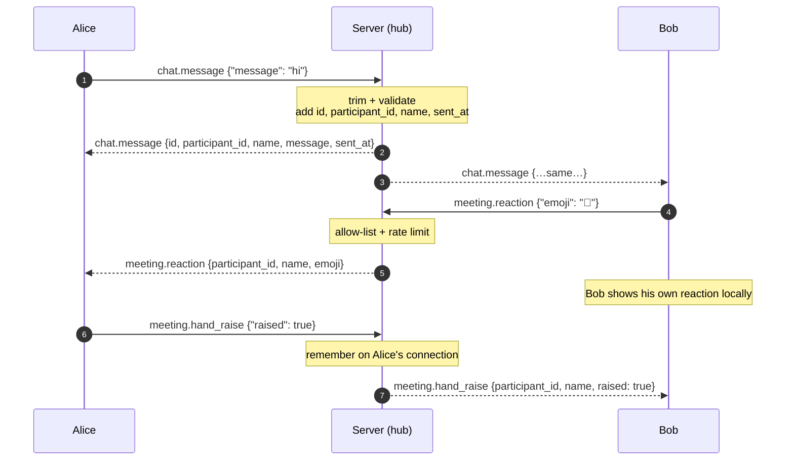

# Protocol reference

How clients talk to the Leet backend: one REST endpoint to create a meeting, and one WebSocket per participant that carries meeting events, chat, reactions, raised hands and WebRTC signaling. Media itself flows over WebRTC (SRTP), not over this socket.

See [architecture.md](architecture.md) for how the pieces fit together and [infra.md](infra.md) for ports and deployment.

## Contents

- [REST](#rest)
- [WebSocket](#websocket)
  - [Client → server](#client--server)
  - [Server → client](#server--client)
- [Call flow](#call-flow)
- [Chat, reactions and raised hands](#chat-reactions-and-raised-hands)
- [Validation and limits](#validation-and-limits)

## REST

Base URL: `http://<host>:8080/api/v1`

All REST responses use the same envelope:

```json
{ "statusCode": 201, "isSuccess": true, "message": "…", "data": { } }
```

### `POST /api/v1/meeting`

Creates a meeting.

```json
{
  "statusCode": 201,
  "isSuccess": true,
  "message": "…",
  "data": { "id": "b1f6…", "code": "3b270fce", "status": "…" }
}
```

## WebSocket

Connect to `ws://<host>:8080/ws/meetings/{code}`. If the meeting doesn't exist, the server returns `404` before upgrading the connection.

Every message is JSON shaped as `{ "type": "<event>", "data": { … } }`. **The first message must be `meeting.join`**, or the server closes the connection.

### Client → server

| Type | Data | Description |
| --- | --- | --- |
| `meeting.join` | `{ "name": "Alice" }` | Join the meeting. Name is required, max 100 characters. |
| `webrtc.offer` | `{ "type": "offer", "sdp": "…" }` | Start (or renegotiate) the media connection |
| `webrtc.answer` | `{ "type": "answer", "sdp": "…" }` | Answer an offer from the server |
| `webrtc.ice_candidate` | `{ "candidate": "…", "sdpMid": "0", "sdpMLineIndex": 0 }` | Local ICE candidate. Send only after your first offer. |
| `chat.message` | `{ "message": "hi" }` | Send a chat message. Trimmed, 1–1000 characters. |
| `meeting.reaction` | `{ "emoji": "🎉" }` | Send a reaction. One of 👍 👏 ❤️ 😂 🎉 😮. |
| `meeting.hand_raise` | `{ "raised": true }` | Raise or lower your hand |

### Server → client

| Type | Data | Sent to |
| --- | --- | --- |
| `meeting.joined` | `{ "participant_id": "…", "name": "…" }` | The joining client (its own id) |
| `meeting.already_exists_participants` | `[{ "participant_id": "…", "name": "…" }]` | The joining client |
| `meeting.participant_joined` | `{ "participant_id": "…", "name": "…" }` | Everyone else |
| `meeting.left` | `{ "participant_id": "…", "name": "…" }` | Everyone else when someone disconnects |
| `webrtc.answer` | `{ "type": "answer", "sdp": "…" }` | Reply to the client's offer |
| `webrtc.offer` | `{ "type": "offer", "sdp": "…" }` | Renegotiation when tracks are added or removed |
| `webrtc.ice_candidate` | `{ "candidate": "…", "sdpMid": "…", "sdpMLineIndex": 0 }` | Server ICE candidates |
| `chat.message` | `{ "id": "…", "participant_id": "…", "name": "…", "message": "…", "sent_at": 1700000000000 }` | Everyone, including the sender. Sender fields come from the server, not the client. Not stored. |
| `meeting.reaction` | `{ "participant_id": "…", "name": "…", "emoji": "🎉" }` | Everyone except the sender (rate-limited per client) |
| `meeting.hand_raise` | `{ "participant_id": "…", "name": "…", "raised": true }` | Everyone except the sender. A joining client also gets one per hand that is already raised. |
| `error` | `{ "code": "…", "message": "…" }` | The client that caused it |

Error codes include `INVALID_FIRST_EVENT`, `INVALID_JOIN_DATA`, `INVALID_NAME`, `INVALID_OFFER`, `INVALID_ANSWER`, `PEER_NOT_FOUND`, `INVALID_ICE_CANDIDATE`, `INVALID_CHAT_MESSAGE`, `INVALID_REACTION`, `INVALID_HAND_RAISE` and `UNKNOWN_EVENT`.

## Call flow

```
Client                                   Server (SFU)
  │ ── WebSocket connect ───────────────────► │
  │ ── meeting.join {name} ─────────────────► │
  │ ◄─ meeting.joined {own id} ────────────── │
  │ ◄─ meeting.already_exists_participants ── │
  │                                           │ ──► others: meeting.participant_joined
  │ ── webrtc.offer (mic + camera) ─────────► │
  │ ◄─ webrtc.answer ──────────────────────── │
  │ ◄─ webrtc.offer (existing participants' tracks)
  │ ── webrtc.answer ───────────────────────► │
  │ ◄──── webrtc.ice_candidate (both ways) ──► │
  │                                           │
  │   …later, someone joins or leaves…        │
  │ ◄─ webrtc.offer (tracks added/removed) ── │
  │ ── webrtc.answer ───────────────────────► │
```

Rules a client must follow:

- Send your first `webrtc.offer` before any ICE candidates. The server rejects candidates for a peer that doesn't exist yet.
- Remote ICE candidates can arrive **before** the answer. Queue them until a remote description is set.
- Answer every `webrtc.offer` the server sends.
- Find a remote track's owner from its stream id (or track id): the part before `:` is the participant id.

## Chat, reactions and raised hands

These events ride on the same WebSocket as everything else. None of them are written to Redis or disk: the server stamps the sender's identity and broadcasts, and the data is gone when the meeting ends.



| | Chat | Reaction | Hand raise |
| --- | --- | --- | --- |
| Event | `chat.message` | `meeting.reaction` | `meeting.hand_raise` |
| Sender gets it back | Yes, shown on echo | No, shown immediately | No, shown immediately |
| Late joiners see it | No | No | Yes, while the hand is up |
| Stored | No | No | Only in memory, on the connection |

Clients must take the sender's identity from `participant_id` and `name` in the **server** payload. Any identity fields a client puts in its own payload are ignored.

## Validation and limits

| Rule | Value | Error code |
| --- | --- | --- |
| First message | Must be `meeting.join` | `INVALID_FIRST_EVENT` (connection closed) |
| Name | Required, max 100 characters | `INVALID_NAME` (connection closed) |
| Chat message | Trimmed, 1–1000 characters | `INVALID_CHAT_MESSAGE` |
| Reaction emoji | One of 👍 👏 ❤️ 😂 🎉 😮 | `INVALID_REACTION` |
| Reaction rate | One per 150 ms per client; extras are dropped silently | — |
| Hand raise | `{ "raised": bool }`; repeating the current state is ignored | `INVALID_HAND_RAISE` |
| Frame size | 1 MiB per WebSocket message | Connection closed |
| Keep-alive | Server pings every 54 s and drops the connection after 60 s without a pong | — |
| Meeting lifetime | 24 hours after creation | `404` on connect |
| Codecs | VP8 video, Opus audio | Negotiation fails if a client supports neither |
